<div align="center">

# 📔 Daily Note

### Дневник, планер и трекер привычек в одном спокойном приложении

Записи дня, настроение, задачи, сон, питание, тренировки и друзья.<br>
Работает в браузере, ставится на телефон и компьютер, синхронизируется между устройствами.

<br>

[](https://daily-notes-io.vercel.app/)
[](https://github.com/Mieqk/Daily-Notes/releases/latest)


<br>

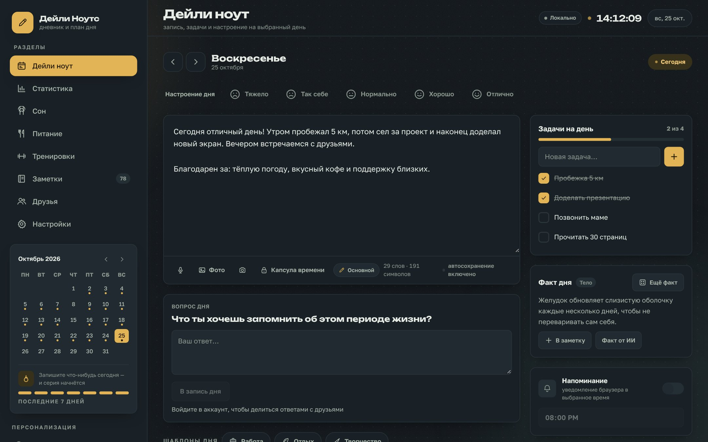

</div>

<br>

## ✨ Что внутри

<table>
<tr>
<td width="33%" valign="top">

### 📝 День
Запись дня с автосохранением, настроение по 5-балльной шкале, задачи с прогрессом, теги, до 6 фото, снимок с камеры, голосовой ввод, шаблоны дня (в том числе свои) и капсула времени. Плагины-виджеты добавляют на страницу дня свои трекеры: воду, энергию, чтение, витамины. Во вкладке «Календарь» можно выбрать сразу несколько дней и расписать на них план: одни и те же задачи в каждый день или по одной строке на день.

</td>
<td width="33%" valign="top">

### 📊 Аналитика
Графики настроения, связь настроения с задачами, тепловая карта за 16 недель, честная серия дней и ИИ-инсайты по цифрам (без текстов записей). Экспорт в Markdown и PDF.

</td>
<td width="33%" valign="top">

### 😴 Сон
Часы считаются сами из «лёг / встал», даже через полночь. Автооценка качества, просыпания, блокнот снов, тренды за 7 и 30 дней, регулярность и долг сна.

</td>
</tr>
<tr>
<td valign="top">

### 🍽 Питание
Свои продукты один раз, дальше в день одним нажатием. КБЖУ и цель по калориям считаются сами. Чат-помощник: «курица 150 г и гречка 200 г» посчитает и добавит.

</td>
<td valign="top">

### 🏋️ Тренировки
Подходы «кг × повторы», прошлый результат и личные рекорды, шаблоны, таймер отдыха и чат-тренер, который составит тренировку под цель.

</td>
<td valign="top">

### 🤝 Друзья
Друзья по коду, профили со статусами, парные привычки, челленджи, Sleep Party, общие воспоминания, благодарности, SOS-поддержка и вопрос дня.

</td>
</tr>
<tr>
<td valign="top">

### 🎨 Свой дизайн
7 тем, включая спокойную «Чистую» и «Свою» с любым цветом. Каждый цвет отдельно, шрифты интерфейса и заголовков, скругления, рамки, тени, плотность. Темой можно поделиться файлом или кодом, а в галерее поставить чужую в один клик.

</td>
<td valign="top">

### 🔄 Синхронизация
Вход по почте или через Google, данные и настройки в реальном времени на всех устройствах. Без аккаунта всё работает локально в браузере.

</td>
<td valign="top">

### 🔒 Приватность
PIN-код и вход по отпечатку или Face ID, закрытые записи на уровне базы (RLS), настройки видимости профиля, экспорт и полное удаление данных.

</td>
</tr>
</table>

Ещё: факт дня от ИИ на вашем языке, Google Календарь (задачи становятся событиями), фоновые пуш-напоминания, календарь месяца с цветом настроения, поиск по архиву, свои эмодзи настроения и фоновые узоры. Интерфейс на 7 языках: русский, English, беларуская, українська, Deutsch, Français, Español.

<br>

## 🎨 Темы под настроение

Готовые темы «Светлая», «Ночная», «Океан», «Лаванда», «Вишня», спокойная «Чистая» без лишних украшений и «Своя», где цвет, фон и текст выбираете вы. Настройки оформления хранятся в аккаунте, поэтому выглядят одинаково на всех устройствах.

<p align="center">
  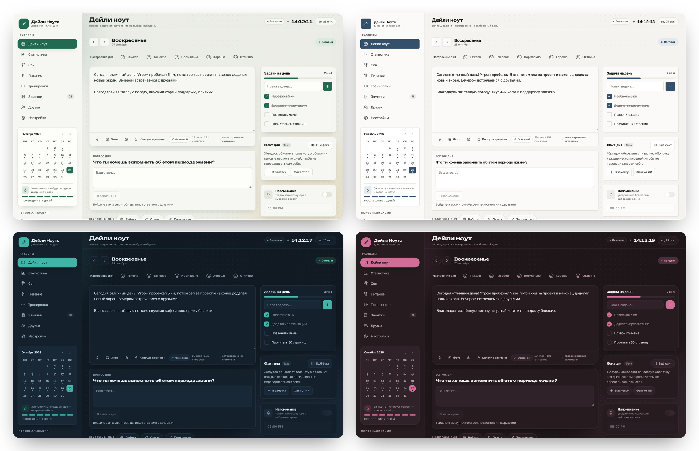
</p>

<p align="center">
  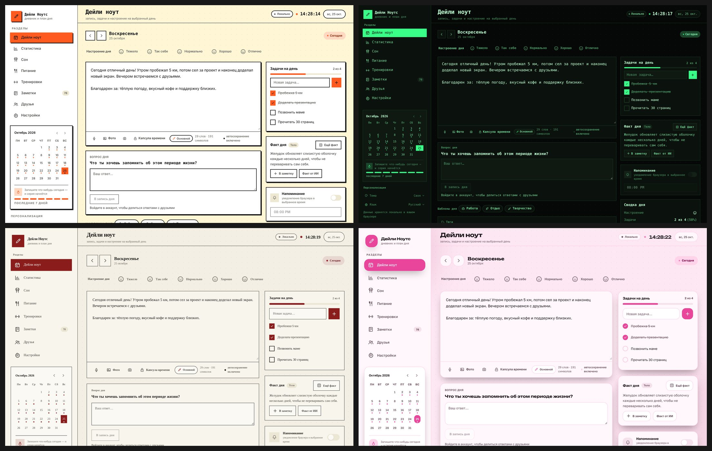
</p>

**Плагины и шаблоны.** В Настройках → «Плагины и шаблоны» можно собрать свой виджет для страницы дня без единой строчки кода: счётчик (стаканы воды), число (минуты, страницы), шкалу 1–10, «да/нет», чек-лист или свой вопрос. У каждого виджета видна полоска за 7 дней. Там же создаются свои шаблоны дня с задачами и заготовкой текста. Плагинами и шаблонами можно поделиться кодом `DNADDON1:…`, файлом или через общую галерею.

<p align="center">
  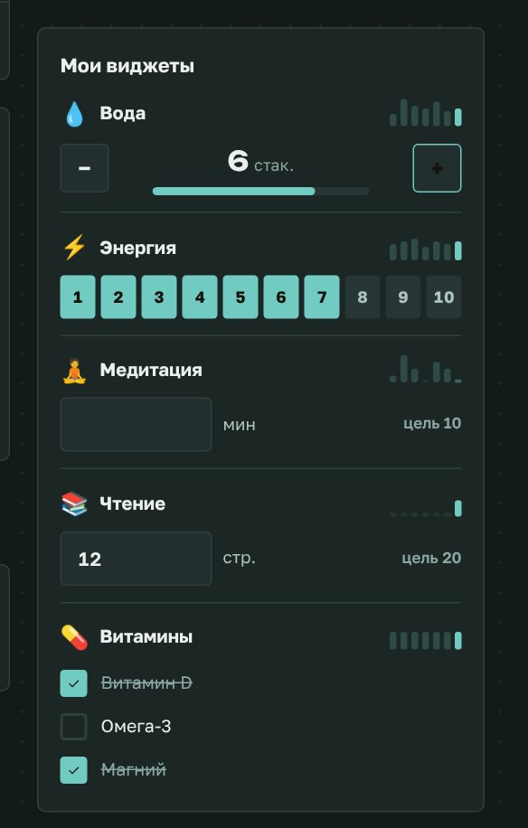
</p>

**Темы от сообщества.** Тему можно изменить до неузнаваемости: задать вручную любой из 13 цветов, отдельный шрифт заголовков, жирные рамки или жёсткие тени. Готовую тему можно скачать файлом `.dntheme.json`, отправить другу кодом `DNTHEME1:…` или выложить в общую галерею, где другие примеряют её одной кнопкой. В теме хранятся только проверенные настройки (цвета и выбор из списков), никакого чужого CSS, поэтому установка безопасна.

<p align="center">
  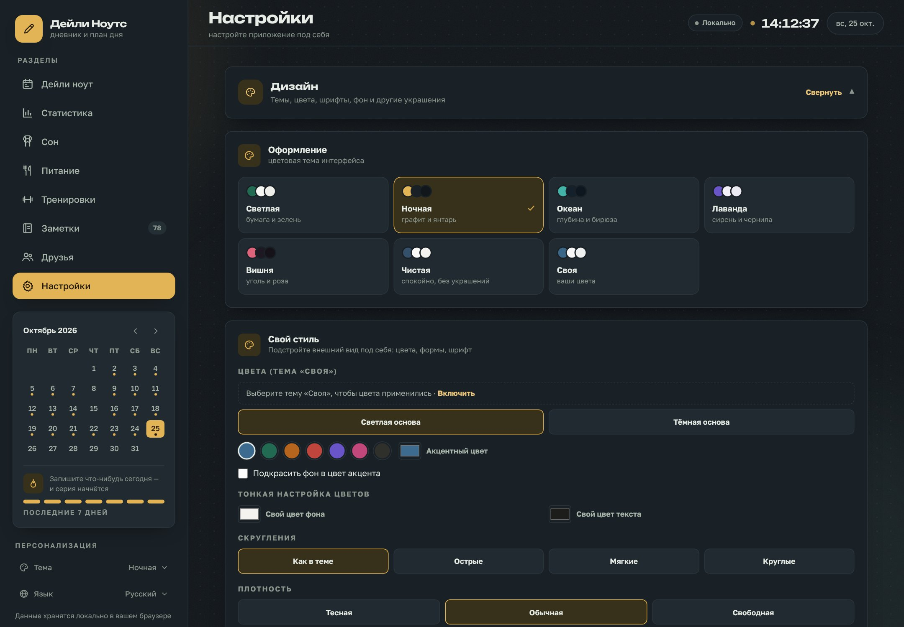
</p>

<br>

## 📱 На телефоне

Удобная мобильная версия: разделы прячутся в выдвижное меню, всё помещается в одну колонку, приложение ставится на домашний экран как обычное.

<p align="center">
  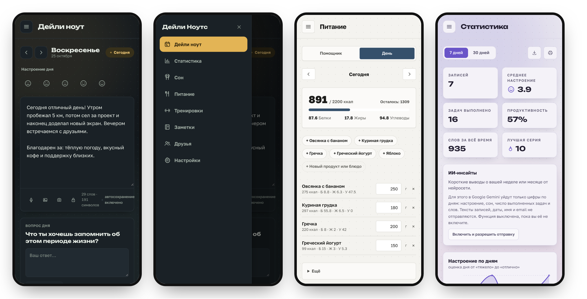
</p>

<br>

## 🖼 Как это выглядит

<table>
<tr>
<td width="50%">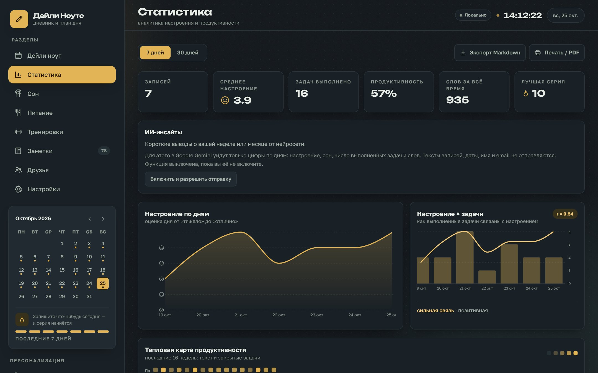<p align="center"><b>Статистика</b> · тема «Чистая»</p></td>
<td width="50%">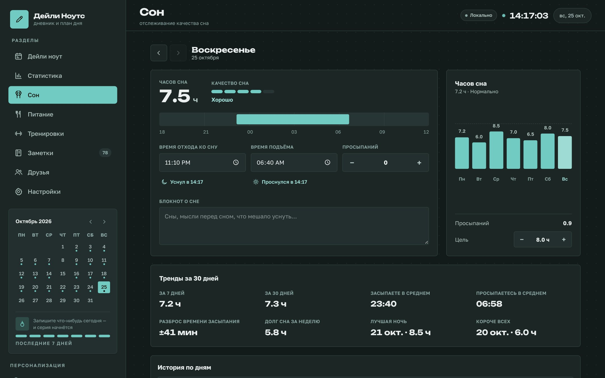<p align="center"><b>Сон</b> · «Своя», бирюза без украшений</p></td>
</tr>
<tr>
<td>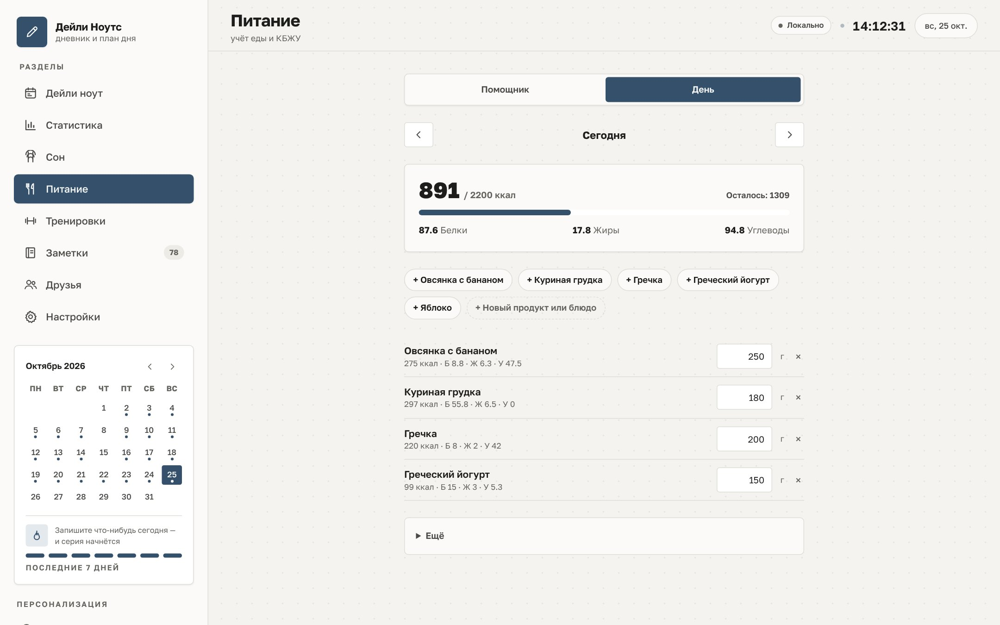<p align="center"><b>Питание</b> · КБЖУ и быстрые продукты, «Чистая»</p></td>
<td>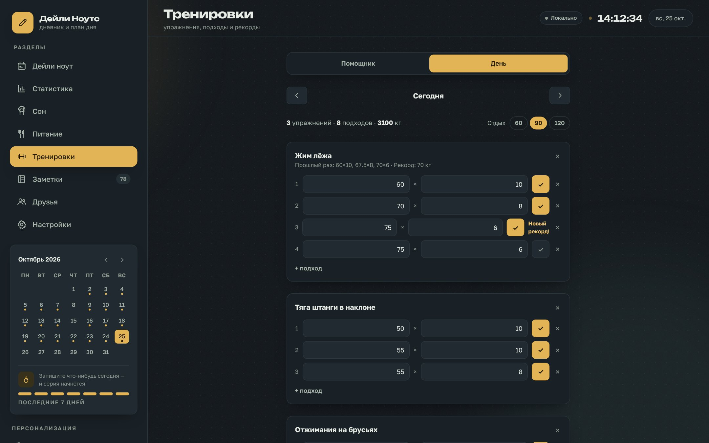<p align="center"><b>Тренировки</b> · «Своя», оранжевый акцент</p></td>
</tr>
<tr>
<td>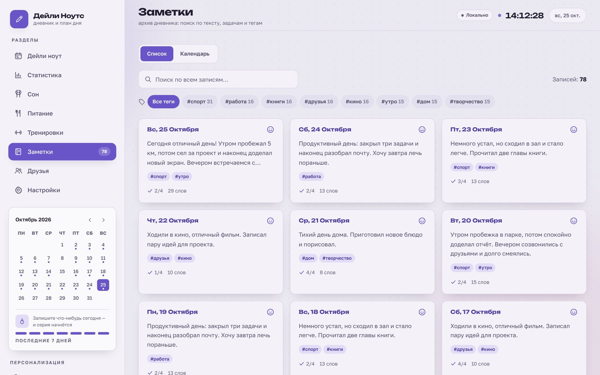<p align="center"><b>Заметки</b> · «Своя», светлая сиреневая</p></td>
<td>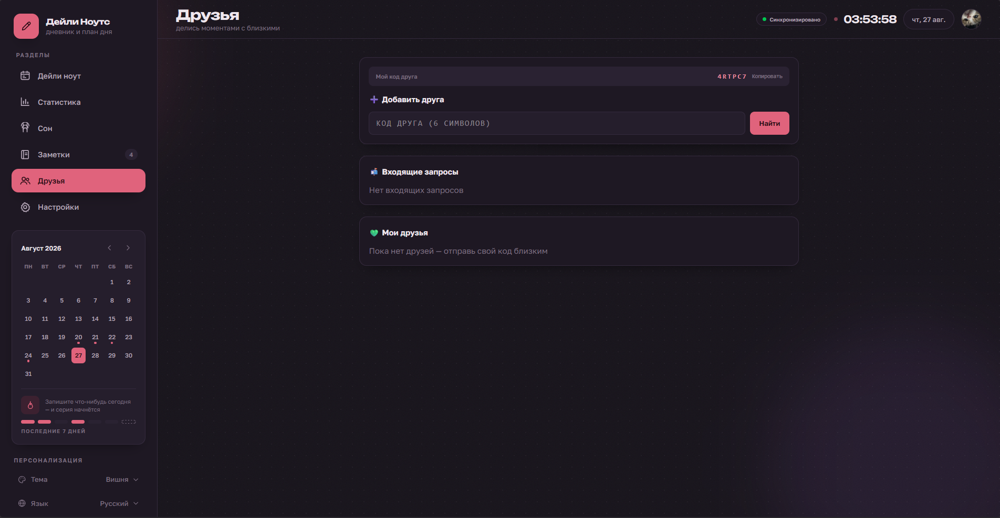<p align="center"><b>Друзья</b> · заявки, привычки, челленджи</p></td>
</tr>
</table>

<br>

## 📲 Установка

**Ссылка на приложение:** https://daily-notes-io.vercel.app/

| Устройство | Как установить |
| :-- | :-- |
| 🍏 **iPhone / iPad** | Откройте ссылку в **Safari** → «Поделиться» → **«На экран "Домой"»** → «Добавить» |
| 🤖 **Android** | Скачайте APK из [Releases](https://github.com/Mieqk/Daily-Notes/releases/latest) **или** откройте ссылку в Chrome → меню ⋮ → **«Установить приложение»** |
| 💻 **Компьютер** | Откройте ссылку в Chrome или Edge → значок установки в адресной строке |

Приложение обновляется само при каждом открытии. Для работы нужен интернет; в локальном режиме данные хранятся в браузере.

### 🍏 iPhone и iPad (через PWA)

Приложения в App Store нет: на iPhone Daily Note ставится как PWA, платный аккаунт Apple не нужен. После установки оно открывается во весь экран с иконкой на экране «Домой».

1. Откройте ссылку в **Safari** и нажмите «Поделиться» (квадрат со стрелкой) внизу экрана.
2. Пролистайте меню и выберите **«На экран "Домой"»**.
3. Нажмите **«Добавить»** и запускайте приложение с новой иконки.

В самом приложении на iPhone появляется подсказка с этими шагами (на 7 языках), а в «Настройках» у блока уведомлений есть кнопка «Показать, как установить».

**Что работает и ограничения iOS:**

- **Пуш-уведомления** приходят при закрытом приложении с **iOS 16.4**, но только если приложение добавлено на экран «Домой»: во вкладке Safari Apple их не даёт. Разрешение запрашивается в настройках уже из установленного приложения.
- **Офлайн:** оболочка приложения кэшируется сервис-воркером, поэтому оно запускается и без сети; данные синхронизируются при появлении интернета.
- **Вход через Google** идёт обычным переходом на страницу Google и возвращает в приложение; вход по e-mail работает как везде.
- **Face ID** (WebAuthn в PIN-блокировке) в установленном приложении зависит от версии iOS; если не заработал, всегда доступен PIN-код.
- Статус-бар на iPhone в режиме приложения остаётся системным (светлым), а отступы под вырез и «домашнюю» полосу учитываются автоматически.
- Эмуляция iPhone в браузере и разбор кода выполнены, но проверка на настоящем iPhone пока не проводилась.

<br>

## 🛠 Технологии

| | |
| :-- | :-- |
| **Интерфейс** | React 18, TypeScript, Tailwind CSS 4, Recharts, Vite |
| **Данные и вход** | Supabase: Postgres, Auth (почта, Google), Storage, Realtime |
| **Сервер** | Vercel Serverless Functions (`/api/*`) |
| **ИИ** | Google Gemini: факт дня, инсайты, помощники по питанию и тренировкам |
| **Мобильные** | PWA, Android APK на Capacitor, Web Push, WebAuthn |

<br>

## 🚀 Запуск у себя

```bash
git clone https://github.com/Mieqk/Daily-Notes.git
cd Daily-Notes
npm install
npm run dev        # разработка
npm run build      # сборка в dist/
```

Без переменных окружения приложение работает в локальном режиме: всё функционально, данные в браузере. Для аккаунтов и синхронизации:

```
VITE_SUPABASE_URL=https://YOUR-PROJECT.supabase.co
VITE_SUPABASE_ANON_KEY=YOUR-ANON-KEY
```

Миграции базы лежат в `supabase/migrations/`, их нужно выполнить по порядку в Supabase → SQL Editor.

<details>
<summary><b>📦 Android APK: сборка и подпись</b></summary>

<br>

APK собирает GitHub Actions (`.github/workflows/android-apk.yml`) и кладёт в раздел **Releases**. Это обёртка [Capacitor](https://capacitorjs.com/), которая открывает https://daily-notes-io.vercel.app (`capacitor.config.json`): приложение обновляется вместе с сайтом, а `/api/*` и пуши работают как в вебе. Минус: нужен интернет. Папка `android/` не хранится в репозитории, а создаётся при сборке.

**Выпуск:** `git tag v1.0.0 && git push origin v1.0.0` (или Actions → *Android APK* → *Run workflow*). Готовый `Daily-Note-1.0.0.apk` появится в Releases.

**Подпись.** Без секретов соберётся отладочный APK (годится для проверки). Для релизного ключа:

1. Создайте keystore (храните его в надёжном месте, потеряв ключ, обновить приложение будет нельзя):
   `keytool -genkeypair -v -keystore release.jks -alias dailynote -keyalg RSA -keysize 2048 -validity 10000`
2. Закодируйте: `base64 -w0 release.jks` (на macOS: `base64 -i release.jks`).
3. В репозитории: Settings → Secrets and variables → Actions → добавьте секреты `ANDROID_KEYSTORE_BASE64` (вывод шага 2), `ANDROID_KEYSTORE_PASSWORD`, `ANDROID_KEY_ALIAS` (`dailynote`), `ANDROID_KEY_PASSWORD`.

**Вход через Google в APK.** Google не пускает вход во встроенный WebView, поэтому в приложении он открывается в системном браузере и возвращается по ссылке `io.vercel.dailynotes://auth`. Один раз добавьте её в Supabase: Authentication → URL Configuration → Redirect URLs → `io.vercel.dailynotes://auth`.

Иконка APK берётся из `public/icons/icon-512.png` при сборке. Файл `release.jks` и пароли не коммитьте. Установка: скачайте APK на телефон и разрешите установку из неизвестных источников.

</details>

<details>
<summary><b>📅 Google Календарь: настройка</b></summary>

<br>

1. Выполните в Supabase → SQL Editor миграцию `supabase/migrations/20261101_google_calendar.sql`.
2. В [Google Cloud Console](https://console.cloud.google.com/) в проекте приложения включите **Google Calendar API** (APIs & Services → Library).
3. APIs & Services → [OAuth consent screen](https://console.cloud.google.com/apis/credentials/consent) → Data Access → Add or remove scopes: добавьте `.../auth/calendar.events` (а также `openid` и `email`). Пока приложение в режиме Testing, добавьте свой адрес в **Test users**.
4. APIs & Services → [Credentials](https://console.cloud.google.com/apis/credentials) → Create credentials → OAuth client ID → Web application. В **Authorized redirect URIs** впишите `https://daily-notes-io.vercel.app/api/gcal`.
5. Переменные в Vercel (Settings → Environment Variables): `GOOGLE_CLIENT_ID`, `GOOGLE_CLIENT_SECRET` и `APP_SUPABASE_SERVICE_ROLE_KEY` (service_role-ключ того проекта Supabase, который указан в `VITE_SUPABASE_URL`; если проект один, достаточно `SUPABASE_SERVICE_ROLE_KEY`). Необязательно: `GOOGLE_REDIRECT_URI`, если адрес отличается от домена сайта. Затем сделайте Redeploy.
6. В приложении: Настройки → Google Календарь → Подключить. В режиме Testing Google показывает «приложение не проверено» (Advanced → Go to …), а доступ истекает через 7 дней; для постоянной работы переведите приложение в In production (для scope календаря Google потребует проверку).

</details>

<details>
<summary><b>🔔 Фоновые пуши: настройка</b></summary>

<br>

1. Выполните в Supabase → SQL Editor миграцию `supabase/migrations/20261029_push_subscriptions.sql`.
2. Сгенерируйте VAPID-ключи: `npx web-push generate-vapid-keys`.
3. Задайте переменные окружения в Vercel (ключи не коммитьте):
   - `VITE_VAPID_PUBLIC_KEY` — публичный ключ (попадает в клиентскую сборку);
   - `VAPID_PUBLIC_KEY` — он же; `VAPID_PRIVATE_KEY` — приватный ключ;
   - `VAPID_SUBJECT` — `mailto:you@example.com` или адрес сайта;
   - `SUPABASE_URL` (или уже заданный `VITE_SUPABASE_URL`) и `SUPABASE_SERVICE_ROLE_KEY` — только на сервере;
   - `CRON_SECRET` — любая длинная случайная строка.
4. Напоминания по времени: запускайте `GET /api/push-reminders` с заголовком `Authorization: Bearer <CRON_SECRET>` каждые 5–15 минут. Готов workflow `.github/workflows/push-reminders.yml`: добавьте секреты репозитория `PUSH_REMINDERS_URL` и `CRON_SECRET`. Vercel Hobby разрешает cron только раз в сутки, поэтому на нём частое расписание не подойдёт.
5. Пересоберите проект на Vercel и включите уведомления в настройках приложения (нужен вход в аккаунт).

</details>

<details>
<summary><b>🤖 ИИ-функции: настройка</b></summary>

<br>

Факт дня, ИИ-инсайты и чат-помощники работают через Google Gemini на сервере. Добавьте в Vercel переменную `GEMINI_API_KEY` и сделайте Redeploy. Инсайты и помощники выключены по умолчанию и включаются только с согласия пользователя; в инсайты уходят лишь цифры по дням, тексты записей не отправляются.

</details>

<br>

## 🔐 Приватность

- **Локальный режим:** данные хранятся только в вашем браузере и никуда не отправляются.
- **С аккаунтом:** данные лежат в Supabase (шифрование на диске, не сквозное). Row Level Security не даёт никому прочитать чужие записи, задачи и сон.
- **Профиль:** статус, «о себе» и баннер можно показывать друзьям или только себе; незнакомцы видят лишь имя и аватар.
- **ИИ:** включается только по согласию, тексты дневника в инсайты не уходят.
- **PIN-код** защищает от случайного взгляда на экран, но это не криптографическая защита. Вход по отпечатку или Face ID работает поверх PIN.
- **Экспорт и удаление:** все данные можно скачать в Markdown или JSON и полностью удалить.

<br>

## 🗺 Roadmap

> ✅ готово · 🔨 в работе · 📋 запланировано · 💡 идея

<details open>
<summary><b>Основное</b></summary>

- [✅] Мобильная адаптация и выдвижное меню разделов
- [✅] PWA с установкой на домашний экран
- [✅] Деплой на Vercel и подключение Supabase (Auth, Database, Storage, Realtime)
- [✅] Синхронизация данных и настроек между устройствами
- [✅] Факт дня от Gemini с офлайн-коллекцией
- [✅] Трекер сна с автоподсчётом часов и качества
- [✅] Календарный вид месяца
- [✅] Питание и тренировки с ИИ-помощниками, синхронизация через аккаунт

</details>

<details>
<summary><b>👥 Социальные функции</b></summary>

- [✅] Регистрация и профили (баннеры, аватары-фото, био, статусы)
- [✅] Система друзей (запросы, список, приватность)
- [✅] Бейджи и ачивки за дружбу
- [✅] Совместные челленджи и групповые цели
- [✅] Парные привычки (Buddy System)
- [✅] Совместное отслеживание сна (Sleep Party)
- [✅] SOS-сигналы и поддержка друзей
- [✅] Благодарности друг другу
- [✅] Вопросы дня с возможностью поделиться
- [✅] Капсула времени
- [✅] Общие воспоминания и совместный доступ к записям

</details>

<details>
<summary><b>📱 Мобильные платформы</b></summary>

- [✅] Фоновые пуш-уведомления (web-push)
- [✅] Биометрический вход (WebAuthn: Face ID, отпечаток, Windows Hello)
- [✅] Камера прямо из записи дня
- [📋] Android APK через GitHub Releases (релиз v1.0.2 вышел, идёт проверка на устройствах)
- [✅] iOS через PWA (на экран «Домой»); приложение в App Store / TestFlight не планируется: нужен платный аккаунт Apple

</details>

<details>
<summary><b>🧠 Аналитика и интеграции</b></summary>

- [✅] Корреляция настроения и продуктивности
- [✅] Тепловая карта продуктивности
- [✅] Расширенная аналитика сна (тренды, регулярность, долг сна)
- [✅] ИИ-инсайты по статистике
- [✅] Экспорт статистики в PDF и Markdown
- [✅] Google Календарь (задачи → события на весь день)
- [📋] Outlook и Apple Calendar (.ics-подписка)

</details>

<details>
<summary><b>🎨 Кастомизация и сообщество</b></summary>

- [✅] Настраиваемые темы: «Чистая», «Своя», конструктор стиля, вкладка «Дизайн»
- [✅] Свои эмодзи настроения и фоновые узоры
- [✅] Темы оформления от сообщества: экспорт файлом и кодом, галерея с установкой в один клик
- [📋] Шаблоны дней от пользователей
- [✅] Плагины-виджеты и свои шаблоны дня: конструктор без кода, обмен кодом и файлом, галерея

</details>

<details>
<summary><b>🔒 Безопасность</b></summary>

- [✅] PIN-код и биометрия для входа
- [✅] RLS-политики Supabase
- [✅] Гибкая приватность профиля
- [✅] Экспорт и удаление всех данных
- [📋] Шифрование чувствительных данных

</details>

<br>

## 🤝 Вклад в проект

Будем рады любым идеям и pull request'ам:

1. Форкните репозиторий
2. Создайте ветку: `git checkout -b feature/my-idea`
3. Закоммитьте изменения и отправьте ветку
4. Откройте Pull Request

<br>

<div align="center">

**Автор:** Miek · Лицензия MIT

Сделано с ❤️ для спокойной саморефлексии и продуктивности

</div>
